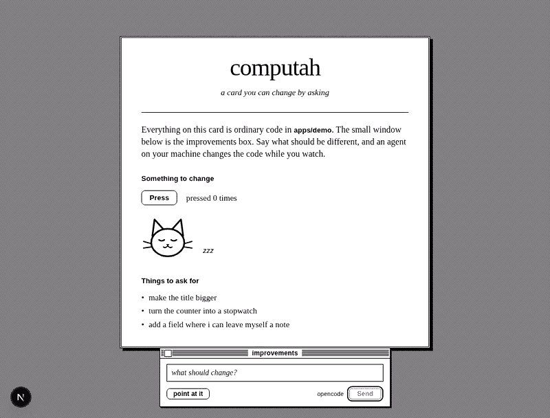

# computah, make this app better

An improvements box for your app. You type what should change, and a coding agent you already have (Claude Code, OpenCode, Codex, Droid, Cursor or Devin) makes the change in your repo while you watch.



The idea is Patrick Collison's: ["a freeform text input that's hooked up to an agent that yolo implements whatever is submitted."](https://x.com/patrickc/status/2116636967517798672) This is that, as a library.

## Ways to use it

| you are                               | you set up                                                             | what happens when someone types in the box                                         |
| ------------------------------------- | ---------------------------------------------------------------------- | ---------------------------------------------------------------------------------- |
| building an app on your laptop        | `<Computah />` and `computah -- next dev`                              | the code on your laptop changes and hot reload shows it in seconds                 |
| using a personal app every day        | the app on a small always-on machine, `computah serve`, you as owner   | the app changes for you from any device, phone included                            |
| sharing an app with family or friends | the same, with them listed as `trusted`                                | it changes for everyone, and anyone trusted can undo it                            |
| running an app for a community        | the same, with `members: "everyone"`                                   | each person changes a version of their own. You promote the good ones to everybody |
| hosting on Vercel                     | a runner on another machine, `release: { push }`, one route in the app | the change is pushed to GitHub and Vercel builds it. Members get a preview link    |

The first row is two lines. Every other row is one config file that names your build commands, your owners, and how to tell who is visiting.

## Use it

In your project (it must be a git repository):

```sh
pnpm add @tetraslam13/computah
```

Put the box anywhere in your app:

```tsx
import { Computah } from "@tetraslam13/computah";

<Computah />;
```

Run the runner next to your dev server:

```json
{ "scripts": { "dev": "computah -- next dev" } }
```

Open your app and press `Ctrl+.` (`⌘.` on a Mac).

## What it does

- **Shows the work.** Each request shows what the agent is doing right now, and every step on demand.
- **Undo.** Every finished change has an undo. It never overwrites edits made since.
- **Leaves no mess.** A request that fails or is stopped keeps none of its edits.
- **Knows where you were.** The page, your selection, the window size, and an element you point at all go to the agent.
- **Queues.** Send several requests; they run one at a time, in order.
- **Commits.** Each change is its own commit, unless it touches files you have uncommitted edits in.
- **Stays out of your styles.** The box lives in a shadow root and has no dependencies beyond React.

## Options

`<Computah>`:

| prop          | default             |                                                                                                                                                      |
| ------------- | ------------------- | ---------------------------------------------------------------------------------------------------------------------------------------------------- |
| `hotkey`      | `"mod+."`           | opens and closes the box                                                                                                                             |
| `title`       | `"improvements"`    | the window's title                                                                                                                                   |
| `launcher`    | `true`              | show the small button that opens it                                                                                                                  |
| `endpoint`    | found automatically | where the runner is. By default: the app's own address if the runner serves it, otherwise `http://127.0.0.1:4821` on a page opened from this machine |
| `defaultOpen` | `false`             | start with the box open                                                                                                                              |
| `secret`      | none                | bearer token, for a runner started with one                                                                                                          |

`computah` (the development runner): `--agent claude|opencode|codex|droid|cursor|devin`, `--model`, `--port`, `--no-commit`, `--cwd`, `--host`, `--secret`, `--origin`. Run `computah --help`.

## Make it look like your app

The default look is a 1-bit window. Change it with a theme:

```tsx
<Computah theme={{ ink: "#e8e6e1", paper: "#17181c", radius: "14px", shadow: "0 18px 50px rgba(0,0,0,.55)" }} />;
```

or the same from CSS, as `--computah-ink`, `--computah-paper`, `--computah-radius` and so on, set on `[data-computah]`. Individual pieces can be restyled with `[data-computah]::part(send)` and friends. For an interface that isn't a floating window at all, `useBox` is the box's logic as a hook. [All of it is in the docs.](https://computah.sh/styling)

## Safety

The runner turns text into code changes, so who can reach it matters.

- By default it listens on this machine only, checks that the connection really comes from this machine, and only accepts browser requests from pages served by this machine. Another website open in your browser can't use it, and neither can another computer on your network.
- To use it from elsewhere, start it with `--secret` and pass the same `secret` to the box. Anyone with the secret can change your code, so only give the box to people you'd give commit access.
- The agent runs with your permissions, the same as when you run it yourself.

## Serve the app itself

In development the box changes the checkout on your machine. To put it in a running app that other people use, let the runner serve the app:

```sh
computah serve
```

It reads `computah.config.mjs`:

```js
export default {
  agent: "codex",
  app: {
    install: "pnpm install --frozen-lockfile",
    build: "pnpm build",
    start: "pnpm start", // must listen on $PORT
    dev: "pnpm dev", // optional: lets the person asking watch their change live
  },
  identity: "exe", // exe.dev's login, "local", or (request) => ({ id, name })
  trust: {
    owners: ["you@example.com"],
    trusted: ["friend@example.com"],
    members: "everyone",
    memberPaths: ["app/**"],
  },
};
```


What each person can do:

| level          | what the box does for them                                                      |
| -------------- | ------------------------------------------------------------------------------- |
| owner, trusted | changes the app for everyone                                                    |
| member         | changes their own version, which only they see. An owner can make it everyone's |
| visitor        | nothing. They never see the box                                                 |

How a change reaches people:

1. The person who asked is moved onto a hot-reloading copy and watches the change happen.
2. Meanwhile the change is built. If the build fails, the agent is shown the error and fixes it, up to three times. Only if it can't is the change taken back out, and nobody else ever saw it.
3. The built copy is swapped in. Pages already open keep talking to the copy that served them, so nothing breaks mid-swap.

Each person's version is a git branch (`computah/u/<name>`); everyone's is `computah/main`. Personal copies start when their person shows up and stop when idle.

When everyone's version changes, it is merged into each person's version. If the two changed the same lines, the agent settles it the next time that person shows up: it is told what they asked for and keeps both. If it can't, their version stays exactly as it was.

## An app on Vercel

Vercel can't run the runner, so the runner lives on another machine with a clone of the repo, and pushes each change to GitHub for Vercel to build.

On the runner, `computah.config.mjs`:

```js
import { gateway, vercel } from "@tetraslam13/computah/server";

export default {
  app: { install: "pnpm install --frozen-lockfile", build: "pnpm build" },
  identity: gateway(process.env.COMPUTAH_SECRET),
  trust: { owners: ["you@example.com"], members: "everyone" },
  release: { push: { branch: "main", host: vercel({ projectId: "prj_..." }) } }, // needs VERCEL_TOKEN
};
```

In the app, one route passes the box's requests to the runner and says who is signed in:

```ts
// app/api/computah/[...path]/route.ts
import { createProxy } from "@tetraslam13/computah/next";

export const { GET, POST } = createProxy({
  runner: process.env.COMPUTAH_RUNNER!,
  secret: process.env.COMPUTAH_SECRET!,
  identify: async (request) => {
    const user = await yourAuth(request);
    return user && { id: user.id, name: user.email };
  },
});
```

and the box points at it: `<Computah endpoint="/api/computah" />`.

- An owner's change is pushed to the branch Vercel serves. The box waits for the deployment and reloads.
- A member's change is pushed to a branch of their own, and the box links to its preview deployment.
- The build is checked on the runner before pushing. If Vercel's build still fails, its log goes to the agent to fix.
- This takes as long as Vercel takes to build, and there is no live preview while you wait.

Another host is one function: `deployed({ sha, branch, production })` waits for the build and returns its address, or throws with the build log.

## Letting anyone change part of your app

For a public app, you can let people who aren't signed in change a few chosen pieces, each in a version only they see:

```js
import { clientOnly, exeSandbox } from "@tetraslam13/computah/server";

export default {
  // ...
  guests: { secret: process.env.COMPUTAH_GUEST_SECRET, forgetMs: 24 * 60 * 60 * 1000 },
  trust: {
    owners: ["you@example.com"],
    members: "everyone",
    memberPaths: ["app/playground/*.tsx"],
    memberCheck: clientOnly(), // each piece must stay a browser-only component that imports only react
    memberNote: "you can change the framed parts of each page.",
    memberRules: 'each piece keeps "use client" first, takes no props, and imports only react.', // for the agent
    memberDailyLimit: 10,
    dailyLimit: 200,
  },
  // A guest's version of one of these is swapped into the running build. Nothing is rebuilt for them.
  pieces: ["app/playground/*.tsx"],
  // A sandbox is started when someone opens the box, so it's ready by the time they've typed.
  sandbox: { in: exeSandbox(), warm: { max: 3 } },
};
```

Render each piece through `<Piece>`, which shows the person's own version of it if they have one:

```tsx
import { Piece } from "@tetraslam13/computah";

<Piece file="app/playground/counter.tsx" stock={Counter} />;
```

With `pieces`, a guest's change is compiled by itself in milliseconds and appears on the page they're on, with no build and no reload. On the docs site, six guests asking at the same moment all had their change in 9 to 15 seconds; building the app for each of them took 27 to 56.

What keeps this safe:

- **A guest's code never runs on your server.** Load each changeable piece with `next/dynamic` and `ssr: false`, from a wrapper outside `memberPaths`. `clientOnly()` rejects a change that stops being a client component, declares server code, or imports anything but `react`.
- **A guest's code runs only in their own browser.** Their changes live in their own version until an owner promotes one.
- **A guest's agent sees only a copy of the code.** With a sandbox it runs on a throwaway machine, without your ignored files.
- **Costs are capped.** Per-person and whole-app daily limits, a cap on agents running at once, and forgotten guests are cleaned up.

## People's own ChatGPT plan

With `chatgpt` set, a person can press **Continue with ChatGPT** in the box, and from then on their requests are made by Codex on their own ChatGPT plan instead of on anything you pay for. This is OpenAI's [Sign in with ChatGPT](https://developers.openai.com/siwc): the person approves it at OpenAI, can limit or revoke it in their ChatGPT settings, and their tokens stay on the runner.

```js
export default {
  // ...
  chatgpt: { require: "members" }, // members must connect before they can send a request
};
```

OpenAI offers this two ways, and which applies to you is their call, not this library's:

- **Open-source and locally hosted apps** need nothing from OpenAI. It works when the person's browser is on the machine the runner is on.
- **A remotely hosted app** needs a client ID from OpenAI ([interest form](https://openai.com/form/sign-in-with-chatgpt-interest/)). Set `chatgpt.clientId`, and register `https://your.app/__computah/chatgpt/callback` as its callback.

## Sandboxes

By default the agent runs on the machine that runs the runner, with that machine's access. A sandbox runs it somewhere disposable instead: the code is copied in (without ignored files, so no `.env`), the agent works there, and only a patch of what it changed comes back.

```js
import { exeSandbox } from "@tetraslam13/computah/server";

export default {
  // ...
  sandbox: { in: exeSandbox() }, // members only. add `for: "everyone"` to sandbox owners too
};
```

| sandbox          | what it is                                                                                | what it needs                                                                     |
| ---------------- | ----------------------------------------------------------------------------------------- | --------------------------------------------------------------------------------- |
| `exeSandbox()`   | a standalone exe.dev VM per request, cut off from the internet except exe's model gateway | an ssh key exe.dev knows, on the runner's machine                                 |
| `modalSandbox()` | a Modal Sandbox per request                                                               | the `modal` package, Modal credentials, and a Modal Secret holding your model key |

Measured: on exe, a real Claude Code change took 12 seconds end to end, about 5 of them starting the VM. On Modal, the first sandbox took 113 seconds while the image built, and 2 seconds after that.

While the agent is in a sandbox there is no live preview: its changes arrive all at once when it finishes.

## Adapters

| kind     | built in                                                  | your own                                 |
| -------- | --------------------------------------------------------- | ---------------------------------------- |
| agent    | `claude`, `opencode`, `codex`, `droid`, `cursor`, `devin` | an object with `command()` and `parse()` |
| identity | `exe`, `local`, `header(name)`                            | a function from request to person        |
| app      | any install, build, start and dev commands                |                                          |
| host     | `vercel`                                                  | an object with `deployed()`              |
| sandbox  | `exeSandbox`, `modalSandbox`                              | an object with `open()`                  |

## Not done yet

- The Vercel adapter has run against a real Vercel project with a scripted agent: a production deploy, a preview for a member, and a failed build that was fixed. The app-side route has only run in tests.
- Without a sandbox, a member's agent runs with the same access to the machine as an owner's. With one, the agent is contained, but the code it writes still runs on the serving machine once built.
- The Modal sandbox has only run with a scripted agent. A real agent there needs a model key in a Modal Secret, which hasn't been tried.

## Develop

```sh
pnpm install
pnpm dev        # the demo card at localhost:3000, with its own box
pnpm lint && pnpm typecheck && pnpm test && pnpm build
```

The look is described in [BRIEF.md](BRIEF.md).

## License

MIT
