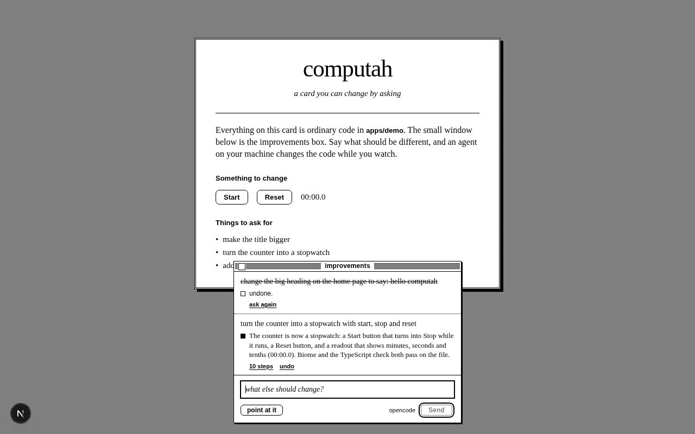

# computah

An improvements box for your app. You type what should change, and a coding agent you already have (Claude Code, OpenCode or Codex) makes the change in your repo while you watch.



The idea is Patrick Collison's: ["a freeform text input that's hooked up to an agent that yolo implements whatever is submitted."](https://x.com/patrickc/status/2116636967517798672) This is that, as a library.

## Use it

In your project (it must be a git repository):

```sh
pnpm add computah
```

Put the box anywhere in your app:

```tsx
import { Computah } from "computah";

<Computah />;
```

Run the runner next to your dev server:

```json
{ "scripts": { "dev": "computah -- next dev" } }
```

Open your app and press `Ctrl+.` (`⌘.` on a Mac).

## What it does

- **Shows the work.** Each request shows what the agent is doing right now, and every step on demand.
- **Undo.** Every finished change has an undo. It never overwrites edits made since.
- **Leaves no mess.** A request that fails or is stopped keeps none of its edits.
- **Knows where you were.** The page, your selection, the window size, and an element you point at all go to the agent.
- **Queues.** Send several requests; they run one at a time, in order.
- **Commits.** Each change is its own commit, unless it touches files you have uncommitted edits in.
- **Stays out of your styles.** The box lives in a shadow root and has no dependencies beyond React.

## Options

`<Computah>`:

| prop       | default                 |                                             |
| ---------- | ----------------------- | ------------------------------------------- |
| `hotkey`   | `"mod+."`               | opens and closes the box                    |
| `title`    | `"improvements"`        | the window's title                          |
| `launcher` | `true`                  | show the small button that opens it         |
| `endpoint` | `http://127.0.0.1:4821` | where the runner is                         |
| `secret`   | none                    | bearer token, for a runner started with one |

`computah` (the runner): `--agent claude|opencode|codex`, `--model`, `--port`, `--no-commit`, `--cwd`, `--host`, `--secret`, `--origin`. Run `computah --help`.

## Safety

The runner turns text into code changes, so who can reach it matters.

- By default it listens on this machine only, checks that the connection really comes from this machine, and only accepts browser requests from pages served by this machine. Another website open in your browser can't use it, and neither can another computer on your network.
- To use it from elsewhere, start it with `--secret` and pass the same `secret` to the box. Anyone with the secret can change your code, so only give the box to people you'd give commit access.
- The agent runs with your permissions, the same as when you run it yourself.

## Not done yet

- Only the OpenCode adapter has been run against the real agent. Claude Code and Codex are written from their documented output formats and tested against sample lines.
- There is no hosted or pull-request mode yet. It's built for the app running on your own machine.
- Not published to npm yet.

## Develop

```sh
pnpm install
pnpm dev        # the demo card at localhost:3000, with its own box
pnpm lint && pnpm typecheck && pnpm test && pnpm build
```

The look is described in [BRIEF.md](BRIEF.md).

## License

MIT
